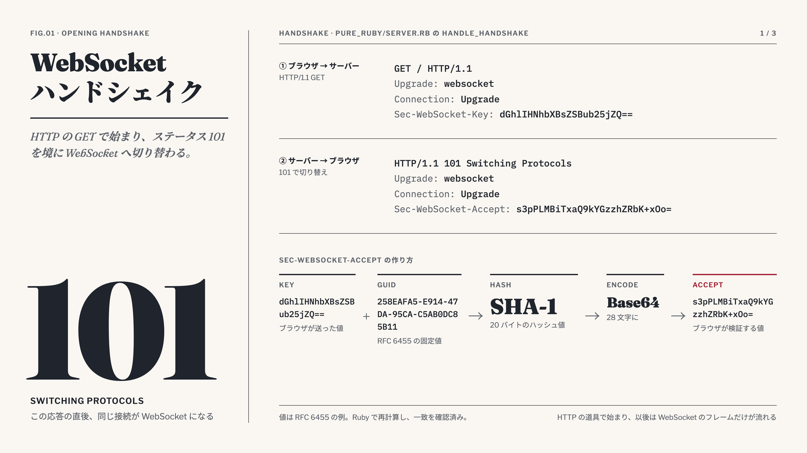
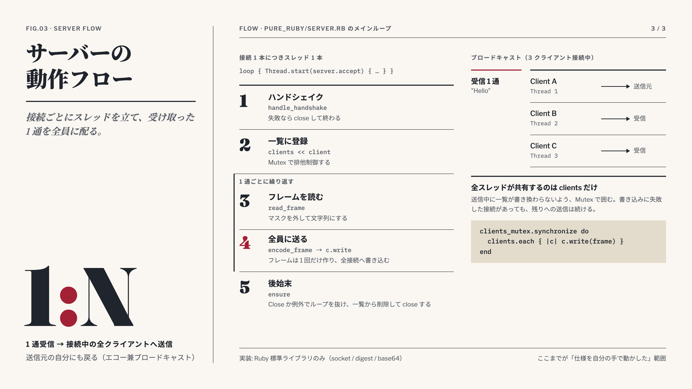
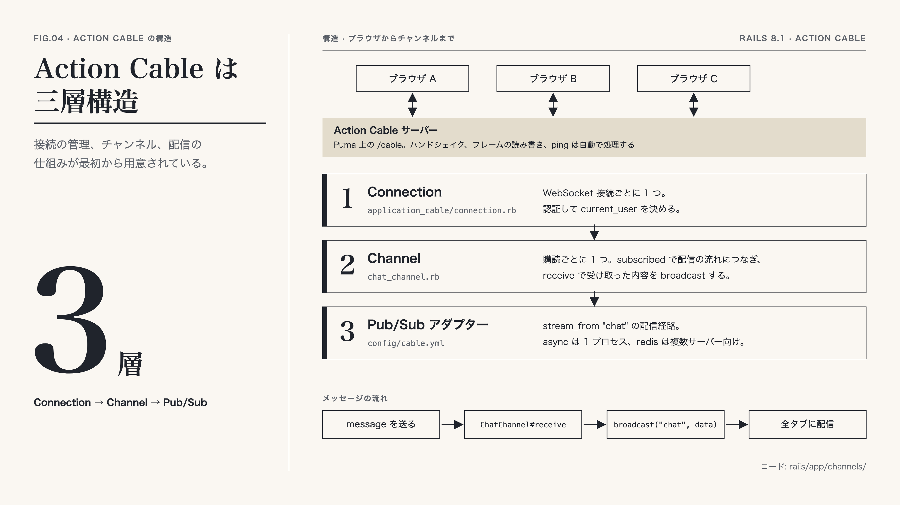

# WebSocket 自作サーバー（Ruby）

WebSocket のプロトコル（RFC 6455）を、ライブラリを使わずに自分の手で実装して学んだ記録です。

## 1. 実装したもの

| ファイル | 役割 |
| --- | --- |
| `pure_ruby/server.rb` | Ruby 標準ライブラリ（`socket` / `digest` / `base64`）だけで書いた WebSocket サーバー。`127.0.0.1:3000` で待ち受けます |
| `test/index.html` | ブラウザ側のテストページ。接続し、文字列を送り、受信したメッセージを一覧表示します |

サーバーの動きは次のとおりです。

- 接続ごとにスレッドを 1 本立てます。
- HTTP の Upgrade ハンドシェイクを自前で処理します。
- 受け取ったフレームのマスクを外して文字列にします。
- 受信した文字列を、接続中の全クライアントへフレームにして送り返します（ブロードキャスト）。
- Close フレームを受け取ったら、接続を一覧から外して閉じます。

### 動かし方

```bash
ruby pure_ruby/server.rb
```

別のターミナルやブラウザで `test/index.html` を開き、文字を入力して送信すると、開いている全タブに同じ文字が表示されます。

## 2. 学んだこと：WebSocket の仕様と実装の対応

### 2.1 オープニングハンドシェイク



接続は WebSocket ではなく HTTP の GET で始まります。ブラウザは `Upgrade: websocket` と `Sec-WebSocket-Key` を送ります。サーバーは次の手順で `Sec-WebSocket-Accept` を作り、`101 Switching Protocols` で返します。

1. ブラウザが送った Key に、RFC 6455 で決まっている固定の GUID を連結します。
2. 連結した文字列を SHA-1 でハッシュ化します（20 バイト）。
3. ハッシュ値を Base64 でエンコードします（28 文字）。

ブラウザは同じ計算をして値を照合し、相手が本当に WebSocket サーバーかどうかを確認します。この 101 の応答を境に、同じ TCP 接続が WebSocket として使われます。`pure_ruby/server.rb` では `handle_handshake` がこの処理を担当しています。

### 2.2 フレーム構造


ハンドシェイク後は、データを「フレーム」という単位でやり取りします。

- **先頭 1 バイト目**：最後のフレームかを示す `FIN`、予約ビット（`RSV1`〜`RSV3`）、種類を示す `opcode`（Text は `0x1`、Close は `0x8`）が入ります。
  > **RSV について**：`RSV` は Reserved（予約）の略で、WebSocket プロトコル（RFC 6455）において将来の機能拡張（Extension、例: `permessage-deflate` などの圧縮拡張）のためにあらかじめ確保されている 3 つの予約ビット（`RSV1`, `RSV2`, `RSV3`）です。拡張機能を使用しない場合は必ず `0` でなければならず、`0` 以外を受信した場合はプロトコル違反として接続を切断する必要があります。
- **先頭 2 バイト目**：`MASK` ビットと、7 ビットの長さが入ります。
- **長さの 3 段階**：長さが 125 以下ならその 7 ビットに収まります。126 のときは続く 2 バイト、127 のときは続く 8 バイトが実際の長さです。
- **マスク**：ブラウザからサーバーへ送るフレームは必ずマスクされ、4 バイトのマスクキーが付きます。サーバーはペイロードの各バイトを、キーの「位置 mod 4」番目のバイトと XOR して元の文字列に戻します。サーバーからブラウザへのフレームはマスクしません。

`pure_ruby/server.rb` では `read_frame` が受信側の解析とマスク解除を、`encode_frame` が送信側のフレーム生成（Text、長さの 3 段階対応）を担当しています。

### 2.3 サーバーの動作フロー



メインのループが接続を受け付け、接続ごとにスレッドを 1 本起動します。各スレッドは次の順に処理します。

1. ハンドシェイクを行い、失敗したら接続を閉じます。
2. 成功したら、クライアント一覧に登録します。一覧はスレッドから同時に触られるため、Mutex で排他制御します。
3. フレームを読み、マスクを外して文字列にします。
4. 同じ文字列を 1 回フレームにし、一覧の全クライアントへ書き込みます。送信元にも戻ります。3 と 4 は、メッセージが届くたびに繰り返します。
5. Close を受け取るか例外が起きたら、ループを抜けて一覧から外し、接続を閉じます。

### 2.4 学習用の最小実装で考慮していない点

このサーバーは、プロトコルの仕組みを理解するための最小実装です。実運用に必要な次の点は、意図的に扱っていません。実装するなら、おおよそ次のようにします。

| 未対応の点 | 実装するなら |
| --- | --- |
| Ping / Pong | opcode `0x9`（Ping）を受けたら、同じペイロードで `0xA`（Pong）を返します。サーバー側からも定期的に Ping を送り、応答のない接続は閉じます。 |
| 分割メッセージ（Continuation） | `FIN = 0` のフレームはバッファに貯めます。続く opcode `0x0` のフレームを追記し、`FIN = 1` が来た時点で 1 通のメッセージとして結合します。 |
| `Origin` の検証 | ハンドシェイクで `Origin` ヘッダーを許可リストと照合し、一致しなければ `403` を返します。ブラウザ以外のクライアントを受け入れるなら、トークンなどの認証も加えます。 |
| opcode の区別 | `opcode` で処理を分けます。Text（`0x1`）と Binary（`0x2`）を区別し、Close（`0x8`）を受けたら Close を返してから閉じます。 |
| ヘッダーとサイズの検証 | `GET`、`Upgrade: websocket`、`Sec-WebSocket-Version: 13` を確認します。ペイロード長に上限を設けます。Text は UTF-8 として正しいかも検証します。 |
| 再接続（クライアント側） | 切断を検知したら、待ち時間を伸ばしながら（指数バックオフ）再接続します。 |
| 複数サーバーへの拡張 | 接続一覧がプロセス内のメモリにあるため、台数を増やすと配信が届きません。Redis の pub/sub などで、サーバー間でメッセージを共有します。 |

これらを一通り備えた実装が必要なら、自作せず Rails の Action Cable のようなライブラリを使うほうが安全です。

## 3. 実務に近い実装：Rails（Action Cable）



Action Cable は、Rails に組み込まれた WebSocket の仕組みです。接続（Connection）、チャンネル（Channel）、配信の経路（Pub/Sub アダプター）の 3 層でできていて、ハンドシェイク、フレームの読み書き、ping による死活監視はサーバー側が自動で行います。使う側は `config/application.rb` で engine を読み込み、Connection と Channel のクラスを書きます。`subscribed` で配信の流れ `chat` につなぎ、`receive` で受け取った内容を `broadcast` で購読者全員に送ります。

```ruby
class ChatChannel < ApplicationCable::Channel
  def subscribed
    stream_from "chat"
  end

  def receive(data)
    ActionCable.server.broadcast("chat", data)
  end
end
```

`pure_ruby` で手書きしていたハンドシェイク、フレームの読み書き、スレッド、接続一覧の Mutex が要らなくなり、チャンネルのコードは 9 行で済みます。2.4 で扱わなかった Origin の検証も最初から入っています。複数サーバーへの拡張も、`config/cable.yml` の `adapter` を `redis` に変え、`redis` gem と Redis サーバーを用意すれば対応できます。

## 参考

- RFC 6455: The WebSocket Protocol
